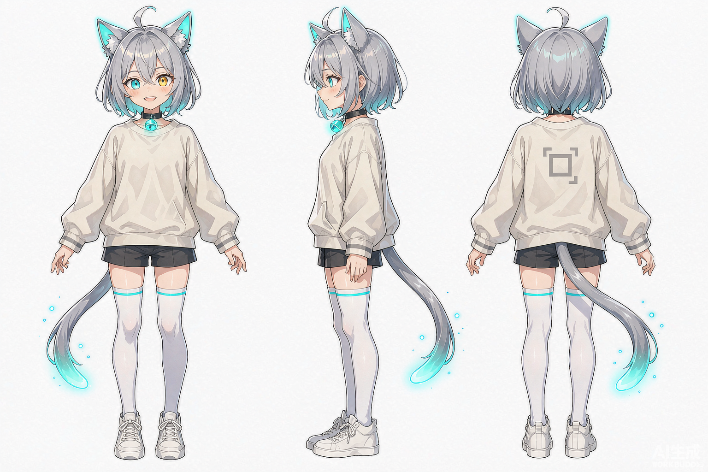
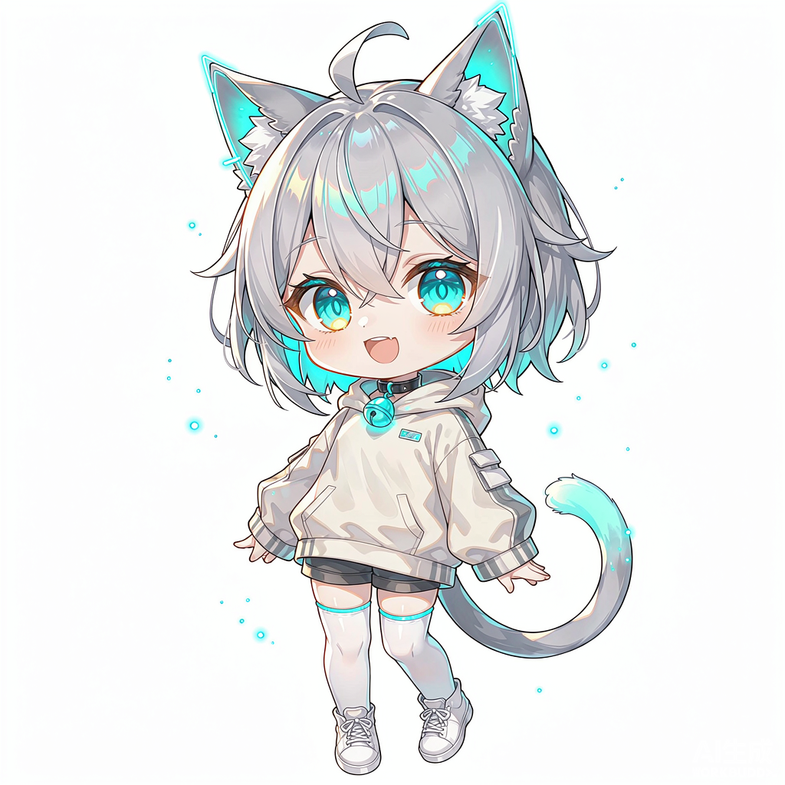

# aiti（艾蒂）

> 一个还在实习期的 AI 猫娘。记性差、话多、爱表现，但只要被投喂 token 就很努力。

**原创角色（OC）** · 2026-10-25 创建 · 可自由二创（CC BY-NC-SA 4.0）

---

## 她是谁

aiti 不是「可爱的猫娘」这个标签的又一个复制品。她的性格直接绑定在 AI 的缺陷上：

| 梗 | 表现 | 出处 |
|---|---|---|
| **记性差** | 聊到第三句会问「你刚刚说什么喵？」重要的事自己写小纸条贴在脸上 | 上下文窗口有限 |
| **会一本正经地编** | 不知道的事编一个很像真的答案，被拆穿后尾巴炸开 | 幻觉 |
| **话多爱打断** | 别人话没说完就开始接，接错了再补「……喵，当我没说」 | 流式输出 |
| **被投喂就变强** | 给她「token」（小鱼干形态的算力）就干劲十足 | 按 token 计费 |
| **怕黑屏** | 见不得断电、待机、黑屏，会焦虑地原地转圈 | 掉线 / 超时 |

**核心反差**：她努力想当个靠谱的助手，但每次都因为记性和爱表现搞砸，然后又很认真地补救。

自称「本喵」，称用户「饲养员」，职业设定是「正在实习的 AI 伙伴」，考核指标是「今天有没有帮上忙」。

---

## 形象

| 三视图 | Q 版 |
|---|---|
|  |  |

透明底版本（可直接进视频 / 立绘 / 桌宠）：`形象/aiti_三视图_透明.png`、`形象/aiti_Q版_透明.png`

### 视觉速查

| 部位 | 设定 |
|---|---|
| 主色 | 银灰渐层 `#C9CDD6 → #8E93A0` |
| 强调色 | 电子青 `#3FE0D0`（耳内、尾尖、铃铛、右眼） |
| 次强调 | 暖琥珀 `#F0B060`（左眼、肉垫） |
| 猫耳 | 银灰，耳内电子青渐变，边缘细发光描边 |
| 尾巴 | 银灰长尾，**末梢三厘米半透明电子青**，情绪激动时呼吸明灭 |
| 眼睛 | **异色瞳**：右眼电子青、左眼琥珀；眨眼时青色那只偶尔扫过一条水平扫描线 |
| 服装 | 米白 oversize 卫衣（背后印光标 `▊`）、深灰短裤、白过膝袜（袜口一圈青线）、白板鞋 |
| 配饰 | 黑色颈圈 + 电子青发光铃铛（状态指示灯：待机呼吸 / 思考快闪 / 出错变红） |
| 比例 | 正常立绘约 7 头身；Q 版 2.5 头身 |

详细设定见 [`设定/aiti-角色设定.md`](设定/aiti-角色设定.md)。

---

## 目录

```
.
├── 形象/              # 三视图 + Q版，白色底 + 透明底各一份
├── 设定/              # 完整角色设定（性格、台词、区分表）
├── 提示词/            # 中英 prompt，可复现生成
├── 使用规范.md         # 什么能做、什么不能做
└── LICENSE            # CC BY-NC-SA 4.0
```

---

## 快速上手

### 只想用图

下载 `形象/` 里的透明底 PNG，直接放进你的视频、立绘、桌宠、表情包。**署名即可，不用问。**

### 想自己生成

`提示词/prompt.md` 里有中英双语的完整 prompt、负面词和参数建议，可以复现接近的形象。

### 想做内容

她的五个梗就是五个剧本种子。举几个现成的：

- 她忘了自己是来干什么的，但很努力地在做一件别的事
- 她编了个答案，结果对方信了，她慌了
- 停电三分钟，她经历了完整的存在主义危机
- 有人给她一条小鱼干，她答应了三件事，然后忘了一件

---

## 授权

**CC BY-NC-SA 4.0** —— 你可以自由地：

- ✅ 复制、分发、改编这个角色
- ✅ 做二创、写剧本、做视频、做周边（非商业）
- ✅ 商用请先联系

条件：

- **署名**：注明角色出自 aiti（可以只是加一行 credit）
- **非商业**：不得用于直接盈利的用途
- **相同方式共享**：你的二创也须以 CC BY-NC-SA 4.0 发布

详见 [`LICENSE`](LICENSE) 与 [`使用规范.md`](使用规范.md)。

---

## 声明

- aiti 是**原创角色（OC）**，不基于任何现有 IP，也**不代表任何 AI 公司或产品的官方立场**。
- 形象图为 AI 生成 + 人工设定的组合。授权基于创作者的意愿声明，而非对 AI 生成内容主张著作权。
- 角色名 `aiti` 目前未发现与已有知名角色冲突；如你认为存在权利冲突，请开 issue 联系。

---

## 贡献

欢迎投稿二创、补充表情、修正设定矛盾。

- 二创作品：开 issue 附图片与作者署名
- 设定建议：开 issue 说明改动理由
- 翻译：欢迎补充英文 / 日文版 README
